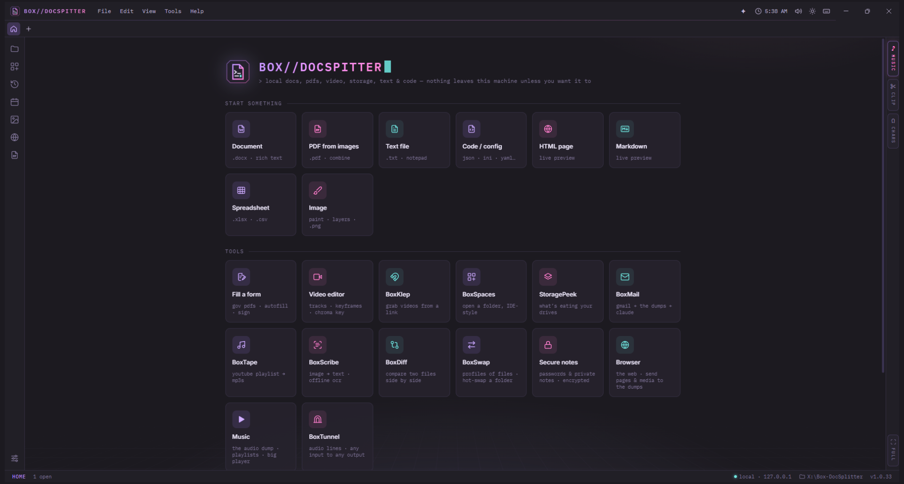

# BOX//DOCSPITTER

https://discord.gg/3qxNWFErAV

> local docs, pdfs, video, storage, text & code — nothing leaves this machine unless you want it to

A self-hosted document workstation that runs entirely on your PC: a Word-style editor, a PDF editor and
form filler, a notepad, a code/config editor, spreadsheets, a layered image editor, offline OCR, a file
compare tool, a multi-track video editor and a quick trimmer, a video grabber, Gmail, a YouTube/Spotify-to-MP3
tool with a music player, audio routing, a folder file-swapper, encrypted Secure notes for passwords, folder
workspaces and a disk-space explorer. Everything is served from `127.0.0.1`. Your files stay on
this machine. The only exceptions are the ones you switch on yourself (Ask Claude, Discord status, BoxMail,
downloads, update checks).

## Start it

| | |
|---|---|
| **Box-DocSpitter.exe** | Starts the app in its own window, with no console. Drag files onto it to open them. On a fresh copy it sets up `node_modules` first. |
| **Create Shortcuts.bat** | Adds Box-DocSpitter to your Desktop and Start menu, with its icon. Run it again after moving the folder. |
| **Box-DocSpitter (with console).bat** | Same as the `.exe`, but shows the server log. |
| **Restore previous version.bat** | Puts back the version from before the last in-app update. Works even if the app won't start. |

The app opens in its own window (built on Electron, in `node_modules/electron`), with its own taskbar icon
and no browser bars. Closing the window stops the server. `npm start` runs the server alone at
http://127.0.0.1:7717 if you'd rather use a browser tab.

## Pin it to the taskbar

Start Box-DocSpitter, right-click its button on the taskbar, and choose **Pin to taskbar**. If you pinned it
before this update, unpin the old one first, because it launches bare Electron. Settings → Windows → **Add to
Start menu & Desktop** makes shortcuts that group with the open window under one icon.

## Open files with Box-DocSpitter

Settings → **Windows** → **Choose file types**: tick PDFs, Word docs, text, config files, spreadsheets and
so on. Box-DocSpitter registers itself for them, just for your Windows account with no admin needed, so it
shows up in "Open with". Windows doesn't let apps make themselves the default, so the next step opens
Settings → Default apps on Box-DocSpitter's page, where you click **Set default**. **Remove** undoes all of
it. If you move the folder, choose the file types again to update the paths.

## Updates

**Settings → Updates → Check for updates** looks at this GitHub repo for a newer version and shows what's
new. **Download** fetches it and checks every file for errors first; **Restart & install** installs it.

- **Your stuff is never touched:** `data/` (settings, keys, history), the three dumps and `node_modules`
  are left alone. So is the small boot file that does the installing (`electron/main.js`).
- **It can't leave you with a broken app:** every replaced file is backed up first. If the new version's
  server crashes, or the app doesn't finish starting within 90 seconds, the previous version is put back
  and restarted automatically, and you're told why.
- **Going back by hand:** **Go back to 1.0.x** in the same place, or `Restore previous version.bat` (needs
  only Windows, so it works even if the app won't open).
- **Not installed from inside the app:** updates that change the boot file or need new libraries say so,
  and are installed by copying the new version over instead.
- **What's new** opens once after every update (notes live in `public/changelog.json`).
- **Private repo?** Paste a read-only GitHub token in Settings → Updates. It's kept in `data/secrets.json`.
- A git checkout (a copy with a `.git` folder) is never updated from inside the app. Use `git pull`.

## Credits

- Made by **boxbind** (Discord: `@boxbind`).
- UI sound effects are from [Pixabay](https://pixabay.com), used under the Pixabay Content License. They
  aren't covered by the code's license. See `public/assets/sounds/SOUNDS-LICENSE.txt`.
- Built on pdf.js, pdf-lib, Monaco, SheetJS, docx, JSZip, marked, ffmpeg.wasm, tesseract.js, Electron,
  nodemailer, ImapFlow, mailparser and the Anthropic SDK (installed by npm under their own licenses). It also
  uses yt-dlp and ffmpeg if you install them.

## Getting it from GitHub

The repo holds only the source (about 2 MB). The libraries and the Electron runtime come from npm:

1. Download or clone this repo.
2. Double-click `Box-DocSpitter.exe`. On first run it does `npm install` (a few hundred MB), then opens the
   app. If Node.js 18+ isn't installed, it asks first and installs it with `winget install OpenJS.NodeJS.LTS`
   (or points you to nodejs.org if winget isn't there). Or install Node.js and run `npm install` yourself.
3. Optional: yt-dlp and ffmpeg, for BoxKlep, BoxTape and faster video exports. BoxTape's **Install them for
   me** button does it with winget, or run `winget install yt-dlp` and `winget install Gyan.FFmpeg` yourself.

Your personal data (`data/`) and the dumps are never part of the repo. They're listed in `.gitignore`.

## Portable: copy it to another PC

The folder is self-contained. Nothing needs installing, not even Node.js, because Electron brings its own.
1. Copy the whole `Box-DocSpitter` folder, including `node_modules`, anywhere: another PC, a USB stick or `C:\Apps`.
   Keep the path reasonably short. Windows can't start programs more than about 260 characters deep.
2. On the new PC, double-click `Create Shortcuts.bat`, or just `Box-DocSpitter.exe`.

Everything the app stores lives in `data\`, including Electron's cache. Nothing goes into `%APPDATA%`.
Before handing a copy to someone else, use **Settings → Reset → Reset to clean state**. It erases settings,
recent files and spaces, drafts, version history, your API key, Discord lines, form-fill info and caches, and
optionally the media dump. Then it restarts the app as a fresh copy. Your own files elsewhere are never touched.
To update a copy that's older than 1.0.3 (before the in-app updater existed), copy the new version over it
once, keeping its `data\` and dump folders. From then on it updates itself from Settings → Updates.
Needs Windows 10 or 11 (64-bit). PDF export uses Edge if it's installed, otherwise the app window's own
renderer. If `node_modules` wasn't copied, the launcher offers to download it, which needs internet once and
Node.js (it offers to install that too, with winget).

## Modes

**Documents** (`.docx`, `.odt`, `.rtf`, `.html`, `.md`, `.txt`)
Paper layout with page markers, styles (Title, Headings, Quote, Code), fonts, sizes, colors and highlight.
Also: lists, checklists, tables (right-click for rows and columns), images (resize, wrap, align), links,
page breaks, table of contents, outline, find & replace, word count and page setup. Saves `.docx`, HTML,
Markdown, RTF or text, and exports PDF. Crash-recovery drafts are kept automatically.
**Pages**: the toolbar buttons next to Print add a blank page (Ctrl+Alt+Enter) or delete the current one
(Ctrl+Alt+Backspace). Each page also has its own add and delete buttons in the right margin, and there's an
**add page** button under the last page. **Pageless** turns the document into one continuous sheet as wide as
the window. PDF export and printing still use pages. **Export as image** saves the current page, every page
as its own file, or the whole document as one long image, as PNG, JPG or WebP at 1×, 2× or 3× sharpness. It can
also copy the image to the clipboard or send it to the media dump.
**Media dump** and **doc dump**: two tabs at the bottom of the editor, backed by the `media-dump/` and
`doc-dump/` folders. Click a picture to insert it, or click a document (PDF, Word, spreadsheet, text…) to open it in a new tab. Right-click copies:
a picture goes to the clipboard as an image, and a document as a file you can paste into Explorer or Discord.
Shift+right-click shows every option. Drag items into the page, or out of the app as real files. Drop or paste
files in to keep them, and use "Save this doc here" to put the open document in the doc dump as a PDF.

**PDF** View, highlight, draw, add text, edit existing text, add shapes, arrows, whiteout, images and
signatures. Fill form fields. Rotate, reorder (drag thumbnails), insert, duplicate, delete and extract
pages, or merge in other PDFs and images. Saves a real PDF, or exports a flattened copy or PNGs. Ctrl+wheel
zooms (here and in PDF from images), and big image pages open fitted to the window.

**Fill a form** A PDF mode built for government-style forms. Forms locked against editing (common on
government sites) are opened as an unlocked copy automatically, so their fields work. It has a field list with progress, "next
empty field", one-click **Autofill** from *My info* (stored only on this PC), and stamps: ✓ ✗ date,
initials and signature. Scanned forms without fields work too: click and type on the lines. **Finalize**
saves a flattened completed copy.

**Text** Notepad-style editing. Wrap, line numbers, fonts, case tools, sort and dedupe lines, encodings
(UTF-8/16, Windows-1252) and CRLF/LF are preserved.

**Code & config** Monaco (VS Code's editor) for JSON, YAML, INI/TOML/.env, XML, HTML, CSS, JS/TS,
Python, PowerShell and more. Includes live preview for HTML and Markdown, formatting, and JSON
minify/sort.

**Spreadsheets** (`.xlsx`, `.xls`, `.ods`, `.csv`, `.tsv`) Formulas (SUM, IF, VLOOKUP, SUMIF, …), sheets,
sort, insert/delete rows and columns, column resize, and live sum/avg of the selection.

**Images** Crop, rotate, flip, resize and adjust colors. Save as PNG, JPG or WebP, or export as PDF.

**Video trimmer** Mark in/out on a filmstrip timeline, preview the loop, and export as an instant
lossless copy, MP4, WebM, GIF, MP3 or WAV. Grab single frames as PNGs, or send them to the media dump.
It runs with the built-in ffmpeg.wasm. If you install real ffmpeg (`winget install Gyan.FFmpeg`),
big files export much faster.

**Video editor** (Tools → Video editor, `.boxcut` projects) Video and audio tracks, pictures on the timeline
(drag an edge to set how long they show), keyframes for position, size, rotation, opacity and volume, chroma
key (green screen) with an eyedropper, and a properties panel for the selected clip. Clips snap to each other's
edges and the playhead; press Shift mid-drag to place one freely. **Shift+click / Shift+drag** seeks on the
timeline or across the preview. Sizes from 720p to 4K (including 1440p and vertical). A **Media dump** tab sits
next to the media list: drag between the dump, the media list and the timeline, drop a clip on the dump to
keep its file, and export straight into it. Exports MP4 through the PC's ffmpeg; formats the browser can't
play get an editing copy automatically.

**BoxKlep** Paste a web page or video link and it finds the videos on that page. You pick which
ones to download, rename them, or send them straight to the trimmer. Direct video files work out of
the box. YouTube and most social sites need **yt-dlp** (`winget install yt-dlp`), which BoxKlep uses
automatically once it's installed. DRM-protected streams are skipped. Only download what you have the
right to keep.

**BoxSpaces** Open a folder like an IDE. You get a file tree with git status colors, search across all
files, Ctrl+E quick-open, and new, rename, duplicate and delete. Delete sends to the Recycle Bin. Hover a
recent space and click × to take it off the list (the folder itself isn't touched).

**StoragePeek** Usage bars for every drive. Scan a drive or folder to get a clickable treemap of what's
using the space, the biggest files, and a breakdown by type and extension. The scanner is a small native
helper (`tools/bds-scan.cs`) compiled on first use by the C# compiler built into Windows. It reads whole
folders at once on every CPU core and counts real on-disk size: a full 1.5-million-file drive takes
seconds. The treemap fills in live while it runs. Space it can't open shows as a striped tile.
**Rescan as admin** asks Windows for permission, then also reads protected folders (restore points,
other users, WindowsApps) and counts the NTFS file table.

**BoxMail** Gmail inside Box-DocSpitter, with as many accounts as you like. The inbox is split into
Gmail's tabs (Primary, Updates, Promotions, Social, Forums), plus Starred, Sent, Drafts, All mail, Spam and
Trash, and Gmail search works (`from:`, `has:attachment`, ...). Compose, reply and forward, with
attachments in one click from the media dump, the doc dump, any open document or your disk. Drop files on
the composer to attach them. **✦ Claude** drafts emails from a note, polishes or shortens them, fixes
grammar, summarizes emails, lists action items and drafts replies. Nothing is sent until you press Send.
Attachments you receive can go straight into the dumps. Setup: Settings → Email → **Add Gmail account**,
with a Google *app password* from myaccount.google.com/apppasswords (needs 2-Step Verification). The password
is stored only in `data/secrets.json`. Mailboxes are opened read-only, so browsing never marks mail as read.
Emails display with no scripts and remote images (tracking pixels) blocked until you load them. Saved
`.eml` files open in BoxMail too, no account needed.

**BoxTape** Paste a YouTube playlist (or an album, or a single video), search for a song, or paste a list of
songs, and pick the tracks. They're saved as MP3s, with title, artist and cover art, into `audio-dump/` for
the ♪ player, 1–6 at a time with per-track progress. Songs already in your audio dump start unticked, and
**Only new songs** ticks just the rest. BoxKlep also has an **MP3** button on every video, and a bulk
**→ MP3** button, for the same thing. Only download music you have the right to keep.
- **Retries:** YouTube sometimes turns a download down when several run at once. A song that fails is tried
  again a few seconds later, up to the number of retries you pick next to *at a time* (none to 10, default 3).
  Songs that can't work (a removed, private or age-locked video) fail straight away and are listed with why.
- **Needs yt-dlp and ffmpeg.** If either is missing, BoxTape says so and **Install them for me** installs them
  with winget (Windows' own package manager). They work straight away, no restart.
- **Spotify links** (playlist, album or song) work too. Spotify's audio is copy-protected, so BoxTape reads
  the track list and finds each song on YouTube: the closest match by length (usually within a couple of
  seconds), title and channel, avoiding live versions, covers, remixes, sped-up/slowed and karaoke unless
  the Spotify title says so. Japanese, Korean and other non-English titles are matched too, and a song that
  isn't found by artist and title is searched again by title alone. Songs with no close match are skipped
  rather than guessed. Files are named `Artist - Title.mp3` with Spotify's tags.
- Up to 100 songs per Spotify link need no setup. For longer playlists, BoxTape links to a free Spotify
  developer key (kept in `data/secrets.json`). Playlists made by Spotify itself stop at 100 either way.

**Image (BoxPaint)** Start something → Image. A lightweight Paint.NET-style editor.
- **Tools:** layers (add, duplicate, delete, reorder, hide, opacity, merge down), brush, eraser,
  line/rectangle/ellipse (outline, fill or both), paint bucket with tolerance, text, colour picker, rectangle
  selection, and move layer.
- **Image menu:** crop to selection, resize, canvas size, flip, rotate. Adjustments: invert, black and white,
  sepia, brightness, contrast, blur, sharpen.
- **Mouse and keys:** the left button paints with the primary colour and the right button with the secondary.
  Shortcuts follow Paint.NET (B, E, L, R, O, F, T, K, S, M, X, D, [ and ]).
- **Bringing images in:** paste or drop images to add them as layers, or pull them in from the media dump.
- **Saving:** PNG, JPG or WebP (layers are flattened), or **To dump** to drop it into the media dump.

**BoxScribe** Offline OCR (image to text). Open, drop or paste images, pick them from the media dump, or
open a scanned PDF (each page is read).
- **Area select:** drag a box to read just part of an image.
- **Clean up:** enlarges small images and boosts contrast, and dark-mode screenshots get inverted.
- **Word boxes:** show what was found, with unsure words in pink.
- **Output:** Copy, Save as .txt, Open as document, or **To clip**, which saves the text as a ✂ clip snippet
  named after the file.
- **Where else:** media dump pictures have **Read text (BoxScribe)** in their Shift+right-click menu.
- **Privacy:** uses tesseract.js with English data shipped in `node_modules`. Nothing is uploaded.

**BoxDiff** Compare two files side by side (Tools → BoxDiff, or right-click a file → **Compare with…**).
Removed lines are red, added lines green, and the exact changed words are highlighted. Prev/next change
(F7 / Shift+F7), inline view, ignore spaces and wrap. Text and code compare as they are; Word, OpenDocument,
RTF, PDF and spreadsheets compare by their text; two pictures compare pixel by pixel with the differences
highlighted. Drop two files on it, one on each half, or pick an open tab or a dump file.

**BoxSwap** Hot-swap sets of files in any folder: a game's mods folder, a config folder, anything. Add the
folder, make profiles (sets of files laid out as they go in it), and switch which one is in. The folder's
own files that a profile replaces are kept aside and put back when it's switched off.
- **Never deletes anything:** a move never lands on an existing file, and only files BoxSwap put in are
  ever taken out. Removing a profile or forgetting a folder moves it into `.removed`.
- **Safe switching:** every move is written to a journal first. If a switch fails halfway (say a game holds a
  file open), or the PC loses power, everything is put back where it was.
- Profiles live in `data/boxswap` (or a master folder you pick). On the same drive a switch is instant.

**BoxTunnel** Audio lines (BoxAudioLine1, 2, …). Each line mixes any number of inputs into one output:
- **Inputs:** a mic or line-in, everything the PC is playing, or another line. Each input has its own
  volume, mute and noise gate, and the line has an optional compressor.
- **Output:** one output device, with a volume, live meters and a **listen** toggle to hear what's going
  through it. Double-click a line to rename it.
- **Keeps running:** lines can carry on with the tab closed, and start when the app opens.
- **Other apps:** they can only pick a line up through a virtual audio cable. Set the line's output to the
  cable.

**Secure notes** (Tools → Secure notes) Passwords and private notes, encrypted on this PC. Each note can
hold a username, a password, a website and free text. Passwords show only while you hold the eye button, and
copying one clears it from the clipboard after 20 seconds. Opening Secure notes always asks for your PIN. See
[Secure notes: encryption and safeguards](#secure-notes-encryption-and-safeguards) below.

**Binary files** A fast hex viewer that identifies the file type.

## Side tabs (right edge)

- **Ω chars**: every Alt code (Alt+1–255 and Alt+0128–0255) plus Unicode symbol sets: arrows, math,
  currency, Greek, box drawing, emoji and more. Searchable by name or code. **Click** adds the character
  to your document. **Right-click** copies it.
- **✦ claude**: optional assistant. Paste your Anthropic API key once. It's saved to
  `data/secrets.json` and never shown again. Then summarize, rewrite, fix grammar, translate or explain
  code, using your selection or the whole file. Text goes to Anthropic only when you press a button.
  Default model: Claude Opus 5.5.

- **✂ clip**: two sub-tabs.
  - **History** keeps what you copy inside Box-DocSpitter: text (Ctrl+C, Copy buttons, characters, paths),
    pictures copied from the media dump, and files copied from the dumps.
  - **Snippets** are texts you save and reuse (addresses, sign-offs, stock replies, form answers).
  - Click to put an item into what you're working on, right-click to copy it again, and Shift+right-click
    for pin, save as snippet, edit, reorder and delete. Everything is stored in `data/clips.json` and erased
    by the factory reset.

## Secure notes: encryption and safeguards

Everything below happens inside the app window's own process (`electron/secure-notes.js`). The local server
never sees your notes, the page only gets what's on screen, and nothing is ever written to disk unencrypted.
Secure notes don't open in a browser tab at all — only in the Box-DocSpitter window.

**What you set up once**

| | What it is | What it's for |
|---|---|---|
| Passphrase | 10+ characters you choose (a few random words is best) | Opening Secure notes after the app starts |
| PIN | 4–32 letters, numbers or symbols | Asked every time you open Secure notes |
| Secure key | `XXXX-XXXX-XXXX-XXXX-XXXX-XXXX`, made for you, shown once — a sticky note is fine | The 30-day check, and opening your notes on a new PC (with the PIN) |
| Key file (optional) | a random file on a USB stick | Makes the passphrase useless without the stick |

**Encryption**

- The notes are encrypted with **AES-256-GCM** under a random 256-bit data key, with a fresh nonce on every
  save. GCM is authenticated: if a single byte of the file is changed, it refuses to open.
- The data key is stored *wrapped* (encrypted) in two slots, never in the clear:
  - **Passphrase slot:** your passphrase goes through **scrypt** (N = 2¹⁸, r = 8: 256 MiB of memory and about
    a second per guess), is combined with a random 256-bit **device key** (and the key file's SHA-256, if you
    use one) through HKDF-SHA256, and that key wraps the data key with AES-256-GCM.
  - **Secure key slot:** the secure key and your PIN go through the same scrypt + HKDF. The secure key is 24
    characters from 32 symbols (no look-alikes), about **120 bits** of randomness.
- The **device key** is sealed with **Windows DPAPI** under your Windows account. A copied vault file can't be
  opened on any other PC or Windows account with the passphrase — only with the secure key + PIN.
- Electron's crypto library has no Argon2, so scrypt (memory-hard, from the same audited library) is used
  rather than adding third-party code to the most sensitive part of the app.

**Safeguards**

- **PIN never unlocks anything on disk.** After a passphrase unlock, the data key is kept in memory, wrapped
  with scrypt(PIN) (64 MiB), while the notes are locked. Five wrong PINs throw it away and the passphrase is
  needed. After the app restarts, the passphrase is always needed. So the PIN can't be guessed offline.
- **Locks itself** when you leave the tab, after a few idle minutes (1–60, your choice), and when Windows
  locks or the PC sleeps. The data key is wiped from memory on lock.
- **30-day secure key check:** every 30 days the secure key has to be typed in before the notes open. The
  date is stored inside the encrypted notes, a clock set backwards counts as due, and five wrong keys lock
  everything.
- **Slower guessing in the app:** after three wrong passphrases or keys, each try waits 1 s, 2 s, 4 s … up
  to 30 s.
- **Passwords stay out of the page** until you hold the eye. Copying goes straight from the window process
  to the clipboard, which is cleared after 20 s and marked so Windows clipboard history (Win+V) and cloud
  clipboard skip it.
- **Screenshots and screen shares** show the window as black while Secure notes are open.
- **Kept out of** Ask Claude, the clip history, crash-recovery drafts, Ctrl+right-click sends and Discord
  status.
- **Safe saving:** each save is written to a temporary file, flushed to disk and swapped in, and the last
  10 versions are kept in `data/secure-notes/backups`. A vault file that's been swapped underneath the app is
  detected and never written over.
- Updates never touch `data/`, and a factory reset keeps Secure notes unless you tick the box to delete them.

**What it can't protect against:** malware already running as you (a keylogger sees what you type, as with
any password manager). And if you lose both the secure key and this PC, the notes can't be recovered — that's
the point of the encryption. Keep the sticky note somewhere other than next to the PC.

## Other handy bits

- **Ctrl+Shift+P** command palette · **Ctrl+E** quick open · **F1** all shortcuts · **F11** focus mode
- **Hover keys**: point at a name and press **F2** to rename it in place, **Del** to remove it. Works on dump
  items, BoxPaint layers, songs, files in the file panel and BoxSpaces, and the home screen's cards, title,
  tagline and logo (F2 on the logo picks a new picture; **Ctrl+F2** puts the original back). Del never
  fires while you're typing in a text box, and everything it removes is recoverable (`.removed` folders,
  the Recycle Bin, or Ctrl+Z for layers).
- **Menus**: press on a menu, drag to an item and let go to pick it, submenus included.
- **Mouse back / forward** (buttons 4 and 5) step between tabs, or between folders over the file panel.
- **Version history**: every save keeps the previous version (File → Version history).
- **App PIN lock** (Settings → Security, off unless you turn it on): asks for a PIN when the app starts, after
  it's been idle, when Windows locks, or on **Ctrl+Alt+L**. The PIN is kept as a scrypt hash in
  `data/applock.json`; after 5 wrong tries the waits grow from 30 s to 15 min. It hides the app — your files
  on disk aren't encrypted by it (Secure notes are).
- **Your setup** (Settings → Your setup): **Export** saves your settings, theme, renames and layout, plus your
  Secure notes (still encrypted), as one `.zip`. **Import** puts them back on another copy or PC. Never the
  dumps, recent files or saved keys.
- **Moving files around the app**: in Files, BoxSpaces, Recent and the dump panels a plain drag picks several
  files, **Shift+drag** carries them into another part of the app (the video editor's timeline, a dump
  folder, a BoxMail email), and **Ctrl+right-click** sends them to the tool that's open.
- **Media dump and Doc dump** buttons in the left sidebar, with folders: make one, click to open it, drop files
  on it to put them inside, Mouse 4 to go back up.
- **Discord status** (Settings → Discord): off by default. Choose automatic lines ("editing a .pdf",
  "changing a config") or write your own. File names are never sent.
- **Themes** (top-bar button or Settings → Appearance): Dark, Light, PB&J and **Custom**. Custom builds a whole
  palette from a background, an accent and a highlight colour (or one of its presets), on a dark or light
  base, with an optional gradient background. Menus, dropdowns, the code editor and tool titles all follow
  the theme. Appearance also has an **Interface font** for the app itself and an **Animations** switch
  (off: nothing slides, fades or eases).
- **Your fonts** (Settings → Appearance): type any Google font's name and click **Get**. Case, spaces,
  dashes and symbols don't matter, and near misses get "Did you mean" suggestions. Fonts come free from
  Fontsource and are saved in `data/fonts`. **Add a font file…** takes a .ttf or .otf of your own.
- **Background image** (Settings → Appearance, or right-click a picture → *Set as app background*): a picture
  behind the whole app, with sliders for how much theme shows over it and blur. It's included in the setup
  export. Pictures also have *Set as desktop background* (Windows; JPG, PNG or BMP).
- Windows open/save dialogs, or the built-in file browser.
- **Sounds** for hover, clicks, typing, opening and closing documents (`public/assets/sounds/`). Click the
  speaker button to mute them. Hover it for a volume slider. Typing and hover sounds can be switched off
  in Settings → Appearance.
- **♪ Music player**: plays everything in the `audio-dump/` folder (mp3, m4a, wav, flac, ogg). It has
  play/pause, skip, shuffle, loop (all or one song), seek and volume, and music keeps playing while you
  work. Media keys work too. Drop songs onto the player or use **+** to add them. **Mixer** is a 10-band
  equalizer (±18 dB) with low cut and high cut, a live response curve, and a preset dropdown (Tinny/phone,
  AM radio, Muffled, Underwater, Lo-fi, Bass boost, Vocal…). **Save preset** keeps your own settings under a
  name, listed under *Yours*; the trash button deletes one. **Duplicates**: an amber button appears when a song is
  in the dump twice, as the very same file under any name or as "Song (1)", "Song - Copy",
  "Song (Official Video)" and the like. You review the list, and the extra copies move to
  `audio-dump/.removed`.

## Where things live

| Folder | What |
|---|---|
| `data/settings.json` | your preferences, Discord lines, My info |
| `data/secrets.json` | keys you add: Anthropic, Gmail app passwords, GitHub token, Spotify key |
| `data/fonts/` | fonts you added under Your fonts |
| `data/backgrounds/` | the app background picture |
| `data/boxswap/` | BoxSwap's profiles, the originals they replaced, and anything removed (`.removed`) |
| `data/backups/` | previous versions of files you saved |
| `data/backups/app/` | the app's own files from before each update (kept for "Go back") |
| `data/update/` | update downloads waiting to install, and how the last one went |
| `data/drafts/` | crash-recovery copies of unsaved work |
| `data/secure-notes/` | Secure notes, encrypted (`notes.bdsv`), this PC's DPAPI-sealed key (`device.key`) and the last 10 versions (`backups/`) |
| `data/applock.json` | the app PIN lock (a scrypt hash); delete it to remove a forgotten app PIN |
| `data/bin/` | the compiled StoragePeek scanner (rebuilt automatically if deleted) |
| `doc-dump/` | the doc dump (removed files go to `doc-dump/.removed`) |
| `audio-dump/` | songs for the ♪ player (removed songs go to `audio-dump/.removed`) |
| `media-dump/` | the media dump: pictures, videos and sounds (removed files go to `media-dump/.removed`; an old `image-dump/` is moved here on start) |

## Under the hood

Node's built-in HTTP server with no frameworks. The page gets a random token per launch, and the server
only answers requests from `127.0.0.1` with that token. Libraries are served from `node_modules`:
pdf.js, pdf-lib, Monaco, SheetJS, docx, JSZip, marked, ffmpeg.wasm, tesseract.js and the Anthropic SDK.

The desktop window is Electron. `electron/main.js` is a tiny boot file that installs updates and rolls them
back; `electron/shell.js` is the window itself, which runs `server.js` as a child process. Server modules:
`mail-server.js` (BoxMail), `update-server.js` (updates), `spotify-server.js` (Spotify links),
`file-assoc.js` (Windows file types), `render-server.js` (video editor export), `swap-server.js` (BoxSwap),
`settings-transfer.js` (setup export/import and the app PIN lock). `electron/secure-notes.js` runs in the window process, not the server.
